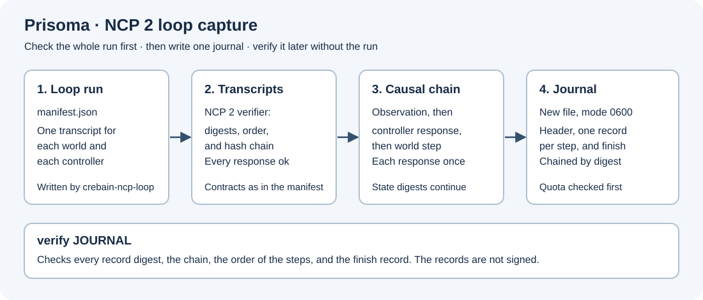

# NCP 2 loop capture

`prisoma-ncp-loop-capture` records one CREBAIN NCP 2 closed-loop run in a bounded journal.
CREBAIN's `crebain-ncp-loop` runs controllers, for example NEST networks, and simulated drone worlds, each with its own NCP 2 session, and writes a `manifest.json` and one transcript for each session.
This crate checks such a run independently and writes its steps into a new journal whose records are chained by digest.
Its profile is `prisoma.ncp-loop-capture.v1`.
It issues no request to any program, has no command, Agent Bridge, estimator, or Host API capability, and opens no network connection.



Text alternative: The import first checks every transcript of the run with the NCP 2 verifier.
It then checks the causal chain from each world observation through the controller responses to the next world step.
Only then does it write a new journal with a header, one record for each step, and a finish record, each chained to the one before by its digest.
A separate verification checks a journal without the run.

The package pins the NCP 2 Rust core, `sepahead-ncp-core` 2.0.0, to one immutable Git revision of the public NCP repository.
It replaces the NCP 1 local capture, `prisoma-ncp-local-capture`, whose three-producer local contract the Git history keeps.

## Build and run

```bash
cargo build --locked --release --manifest-path crates/ncp-loop-capture/Cargo.toml
just ncp-loop-capture-check
```

```text
prisoma-ncp-loop-capture import RUN_DIR JOURNAL [--max-bytes N]
prisoma-ncp-loop-capture verify JOURNAL
```

`import` prints a JSON report with the numbers of worlds, controllers, steps, and records, the journal size, and the last record digest.
`verify` prints the same report for a journal.
Both exit with status 1 and a reason on standard error when a check fails.

## What the import checks

Every check completes before the journal exists:

- Each transcript passes the NCP 2 transcript verifier (frame digests, sequence numbers, and the hash chain) and holds one client session whose every request got an `ok` response.
- Each session opens the application and the contract identity that the manifest names: `crebain.body` for worlds and `crebain.controller` for controllers.
- Each controller answers steps 1 to N in order for its own drones and echoes each step, state digest, and drone list.
- Each world step starts from the state digest of the world's previous observation.
- Each controller request carries exactly that observation of its drones.
- The step's accelerations equal the named controller responses' accelerations exactly.
- Every drone has exactly one proposal, and every controller response is applied exactly once.
- Each world result continues the kernel's own state chain, and each world finishes cleanly from its last state.

The manifest may name only plain file names inside the run directory.
The journal path must not exist; the file is created with mode `0600` and refuses a final symbolic link.
The default and largest quota is 128 MiB, and a journal that would exceed the quota is refused before it is created.
The import synchronizes the journal and its directory.

The loop host records each request before it sends it (NCP 2 specification, section 10), so a complete transcript holds every request that a world or a controller may have executed.

## The journal

Each line is one JSON record with the members `ordinal`, `previous`, `kind`, `data`, and `record_digest`.
`record_digest` is the SHA-256 digest of the profile name, a newline, and the record's compact JSON without `record_digest`.
`previous` is the digest of the record before, or `null` for the first.
The first record holds the profile, the manifest, and the SHA-256 digest of each transcript file.
Each step record holds, for every world, the request and response identities, the source and resulting state digests, the intended and applied accelerations, the true positions, the observation, and the Kalman innovations, and, for every controller response, its identities, drones, and accelerations.
The finish record holds the number of steps and each world's final state digest.

`verify` checks every record digest, the chain, that the steps follow one another from 1, that the finish record ends the journal, and that every record has exactly the canonical encoding.

## Limits

- The transcripts and the journal are not signed. The checks find damaged and inconsistent records, not a complete and consistent forgery of every file.
- A failure while writing leaves a journal without its finish record, which `verify` rejects.
- The journal records what the transcripts show. It does not establish who produced them, physical behavior, or any scientific result.
